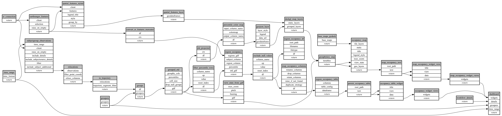

```
# AUTOGENERATED BY ECOSCOPE-WORKFLOWS; see fingerprint in README.md for details

```

```yaml
# fingerprint:
artifacts_sha256_basic: 87c244145ab86beaf6e1b2c8f82012956f97a9582ccf052e65d7a40b3be4de0a
artifacts_sha256_strict: d7b455a332cf392543a68644ccf3f0447eef722c74e24fc2ce110ae121635778
installed_requirements:
- channel: https://repo.prefix.dev/ecoscope-workflows/
  name: ecoscope-platform
  version: {version: ==2.25.3}
- channel: https://repo.prefix.dev/ecoscope-workflows-custom/
  name: ecoscope-workflows-ext-custom
  version: {version: ==0.1.0rc14}
- channel: https://repo.prefix.dev/ecoscope-workflows-custom/
  name: ecoscope-workflows-ext-ste
  version: {version: ==0.0.0rc1}
- channel: https://repo.prefix.dev/ecoscope-workflows-custom/
  name: ecoscope-workflows-ext-mnc
  version: {version: ==1.0.6}
- channel: https://repo.prefix.dev/ecoscope-workflows-custom/
  name: ecoscope-workflows-ext-big-life
  version: {version: ==1.0.2}
- channel: https://repo.prefix.dev/ecoscope-workflows-custom/
  name: ecoscope-workflows-ext-mep
  version: {version: ==1.10.0}
- channel: conda-forge
  name: pydeck
  version: {version: ==0.9.2}
params_sha256: 47ebe6f7ff4168beb93d1b7aff11028629fd17dd16dcead185cd2983c7b16687
spec_sha256: 1f2f3d746078907a5ded7fec2cc6e9083d33c937f9c68e8051191909fd3330a4

```

# ecoscope-workflows-subject-occupancy-roi-workflow


