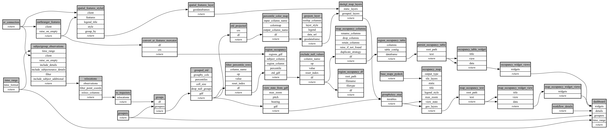

```
# AUTOGENERATED BY ECOSCOPE-WORKFLOWS; see fingerprint in README.md for details

```

```yaml
# fingerprint:
artifacts_sha256_basic: 45d86b215e9300379980b5957b0e263edab885a3a129beede28256350871ac01
artifacts_sha256_strict: 67c64633578b41306479356acc589fb40b21c465e37159167455780a05e21ae3
installed_requirements:
- channel: https://repo.prefix.dev/ecoscope-workflows/
  name: ecoscope-platform
  version: {version: ==2.25.3}
- channel: https://repo.prefix.dev/ecoscope-workflows-custom/
  name: ecoscope-workflows-ext-custom
  version: {version: ==0.1.4}
- channel: https://repo.prefix.dev/ecoscope-workflows-custom/
  name: ecoscope-workflows-ext-ste
  version: {version: ==0.0.24}
- channel: https://repo.prefix.dev/ecoscope-workflows-custom/
  name: ecoscope-workflows-ext-mep
  version: {version: ==1.10.7}
- channel: conda-forge
  name: pydeck
  version: {version: ==0.9.2}
params_sha256: db8cc978244016f47ebba712727f1c0755fb40c0d77020a6458056a9f376e8d1
spec_sha256: c859661417cc9307508d4f98f634a3b1fc564c9d60fc450a25b29301bab56777

```

# ecoscope-workflows-subject-occupancy-roi-workflow


